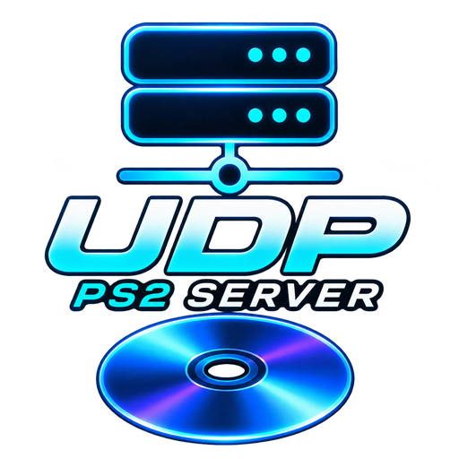

<p align="center"></p>

# UDPBD PS2 Server · Linux

Comparte tu carpeta de juegos de PlayStation 2 por red mediante **UDPBD v2**,
con una interfaz gráfica sencilla para Linux. Compatible con clientes UDPBD
como OPL y OSD-XMB/Neutrino que incorporen este protocolo.

## Por qué existe

Este proyecto nace de la necesidad de disponer en Linux de un servidor UDPBD
fácil de utilizar, sin depender de un ejecutable para Windows ni de preparar
manualmente una unidad de disco. Seleccionas una carpeta, eliges la interfaz
de red y pulsas **Iniciar servidor**.

- Interfaz gráfica con inicio/parada, estado y tráfico en directo.
- Comparte ISO sueltas, carpetas `DVD`/`CD` o una biblioteca con estructura OPL.
- No copia los juegos ni modifica los archivos originales del ordenador.
- Crea una unidad exFAT virtual y admite las escrituras temporales del cliente.
- Muestra la IP que debes usar en tu PS2.
- No necesita permisos de administrador para funcionar.

## Descargar

**[Descargas de la última versión](https://github.com/N3ruk/UDPBD-PS2-Server-Linux/releases/latest)**

| Paquete | Uso |
| --- | --- |
| `UDPBD-PS2-Server-1.0.0-x86_64.AppImage` | Ejecutar sin instalar Python, Tk ni el servidor. |
| `udpbd-ps2-server_1.0.0_amd64.deb` | Instalación integrada en Ubuntu y en su menú de aplicaciones. |

Ambos paquetes son **x86_64/amd64**, no ARM ni 32 bits. No se incluyen juegos.

### AppImage · sin instalación

En Propiedades del archivo, permite ejecutarlo como programa y ábrelo.
También puedes ejecutarlo así:

```bash
chmod +x UDPBD-PS2-Server-1.0.0-x86_64.AppImage
./UDPBD-PS2-Server-1.0.0-x86_64.AppImage
```

Incluye Python, Tcl/Tk, fuentes, interfaz y backend. Requiere Linux con glibc
2.31 o posterior y una sesión gráfica X11 o Wayland con XWayland.
Si tu distribución no tiene FUSE disponible, no necesitas instalarlo:

```bash
./UDPBD-PS2-Server-1.0.0-x86_64.AppImage --appimage-extract-and-run
```

No registra servicios ni instala archivos en el sistema.

### Ubuntu · paquete DEB

Desde la carpeta donde lo descargaste:

```bash
sudo apt install ./udpbd-ps2-server_1.0.0_amd64.deb
```

`apt` instala automáticamente Python 3, Tk y las fuentes necesarias si faltan.
Después abre **UDPBD PS2 Server** desde el menú de aplicaciones.
Diseñado para Ubuntu 22.04 o posterior (amd64). La instalación, prueba y retirada
del DEB se verifican en Ubuntu 22.04 mediante GitHub CI; la interfaz y la AppImage
también se han comprobado en Ubuntu 26.04.1. No uses `dpkg -i` como sustituto de `apt` si faltan dependencias.

## Usarlo con tu PS2

1. Conecta el PC y la PS2 a la misma red; se recomienda Ethernet.
2. Abre la aplicación y selecciona la carpeta de juegos.
3. Elige la IP/interfaz conectada a la PS2, especialmente si también tienes Wi-Fi.
4. Pulsa **Iniciar servidor** y espera a que aparezca el estado activo.
5. En tu cargador de PS2, utiliza el modo UDPBD y, si solicita una IP de servidor,
   escribe la que muestra la aplicación. El servicio usa **UDP 48573**.
6. Consulta el tráfico en directo y pulsa **Parar servidor** cuando termines.

Puedes seleccionar directamente `DVD`, `CD`, una carpeta con ISO sueltas o la
raíz de tu biblioteca OPL. Mantén los archivos sin cambios mientras compartes.
No hace falta formatear, montar ni dedicar una partición al servidor.

### Qué significa escritura temporal

El cliente puede escribir en la unidad virtual mientras el servidor está activo,
pero esos cambios **se descartan al parar o cerrar**. Las ISO originales permanecen
intactas. **No uses este modo para guardar partidas VMC que quieras conservar
entre sesiones**: guarda en una Memory Card física u otro almacenamiento persistente.
No hay modo de importación ni copia permanente de la biblioteca.

## Si no aparece la lista de juegos

- Comprueba que el cargador de PS2 incorpora soporte UDPBD v2; no es SMB.
- Revisa la interfaz seleccionada y que ambas máquinas estén en la misma subred.
- Si hay un cortafuegos activo, permite UDP 48573 desde tu red local.
- Cierra otra instancia del servidor que pueda estar ocupando el puerto.
- Mira el registro de la propia ventana para identificar errores de archivos o red.

No se modifica el cortafuegos automáticamente. El programa no descarga juegos
ni necesita acceder a Internet para compartirlos.

## Comprobar y desinstalar

La aplicación incluye una prueba opcional de interfaz y UDP sobre archivos
ficticios y loopback. Requiere una sesión gráfica; no contacta con la PS2:

```bash
udpbd-ps2-server --self-test
# O con AppImage:
./UDPBD-PS2-Server-1.0.0-x86_64.AppImage --self-test
```

Para retirar la instalación Ubuntu:

```bash
sudo apt purge udpbd-ps2-server
```

Para retirar la AppImage basta con borrar su archivo. Tus juegos nunca se borran.
Las preferencias están en `~/.config/udpbd-ubuntu/` y los registros locales en
`~/.local/state/udpbd-ubuntu/`; puedes borrarlos por separado si ya no los necesitas.

## Código y construcción

Python 3.10+, Tk y un compilador C++17 permiten ejecutar desde fuentes:

```bash
make
python3 main.py
```

Para generar los dos paquetes: `python3 packaging/build.py`.
Necesitas Python 3, `make`, `dpkg-deb`, `tar`, `xz`, `strip` y acceso a Internet
para la primera descarga de las herramientas fijadas en
`packaging/toolchain-lock.json`. No se instala ninguna herramienta globalmente.

[Créditos y licencias](NOTICE.md).
